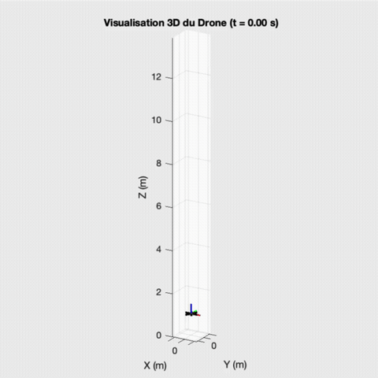
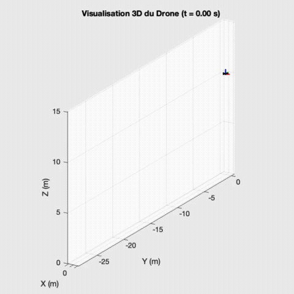
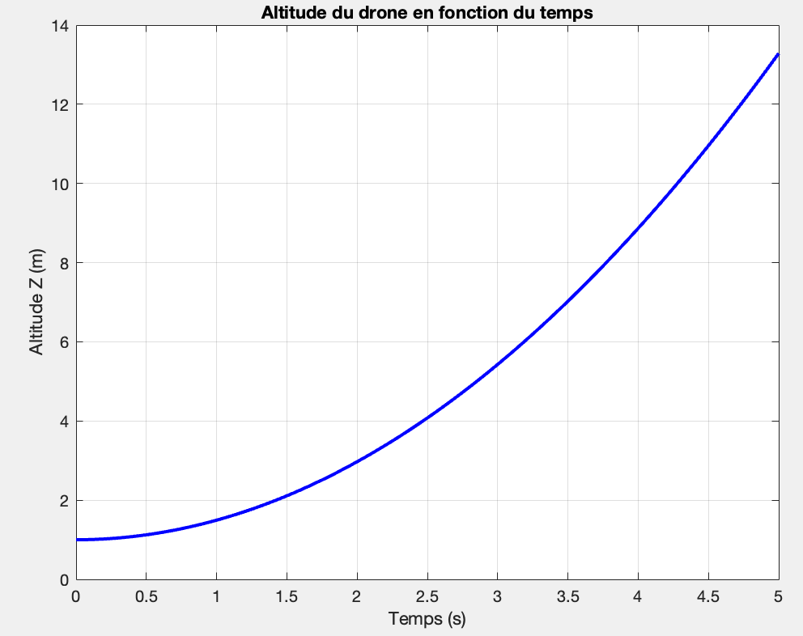
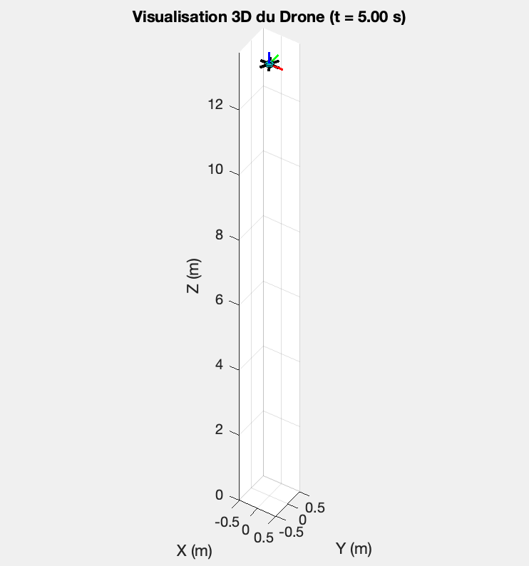
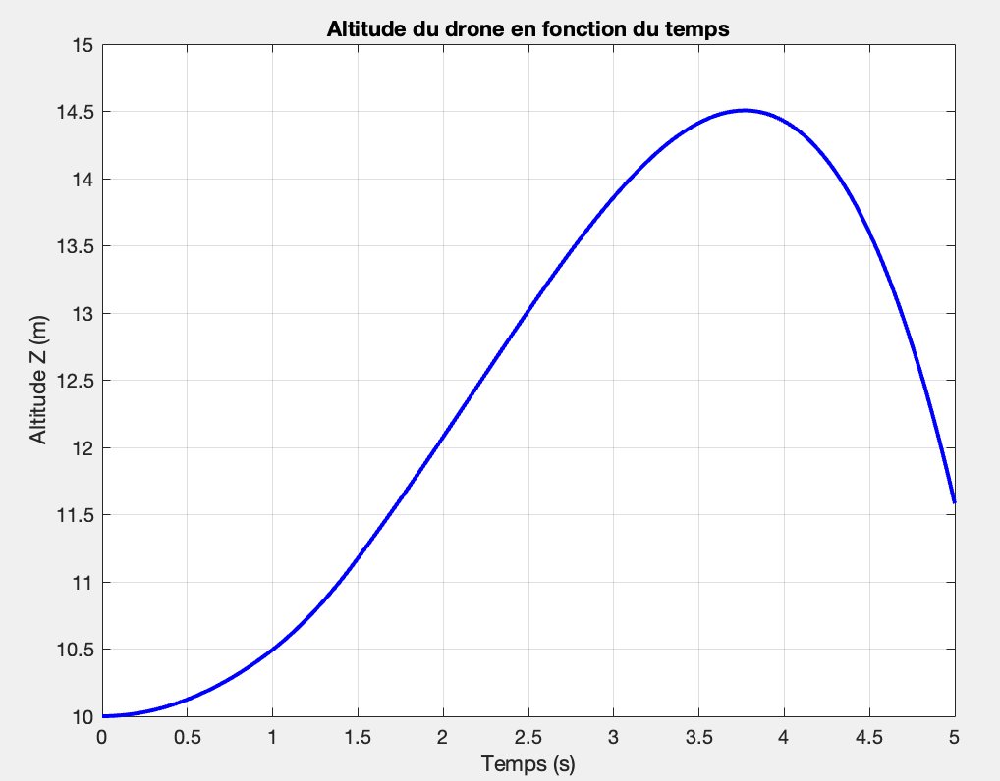
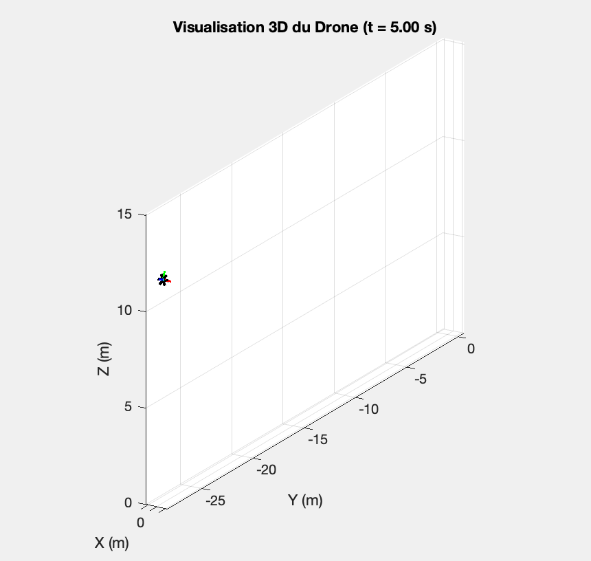

# Drone Simulator — Dynamique d'un hexacoptère sous MATLAB

Simulateur 6 degrés de liberté d'un drone à six hélices, construit à partir des équations de **Newton-Euler** du corps rigide. Le projet couvre toute la chaîne : modélisation mécanique, mise en équations, intégration numérique avec `ode45` et animation 3D de l'attitude et de la trajectoire.

<p align="center">
  
  &nbsp;
  
</p>
<p align="center"><em>À gauche : montée verticale. À droite : décollage puis manœuvre en roulis et translation latérale.</em></p>

---

## Sommaire

- [Objectifs](#objectifs)
- [Modélisation](#modélisation)
- [Architecture du code](#architecture-du-code)
- [Scénarios simulés et résultats](#scénarios-simulés-et-résultats)
- [Lancer la simulation](#lancer-la-simulation)
- [Limites et pistes d'amélioration](#limites-et-pistes-damélioration)

---

## Objectifs

- Modéliser la **cinématique** d'un hexacoptère (repères, angles d'Euler, matrice de rotation, jacobienne).
- Établir sa **dynamique** (bilan des forces et moments, matrice d'inertie, équations de Newton-Euler).
- Implémenter un **simulateur MATLAB** modulaire, réutilisable avec n'importe quelle loi de commande moteur.
- **Visualiser** le comportement du drone en 3D et valider le modèle sur des cas simples puis sur une manœuvre plus riche.

---

## Modélisation

### Hypothèses

- Le drone est un **corps rigide**, symétrique, avec son centre de gravité au centre géométrique.
- Les moteurs sont idéaux : la poussée est proportionnelle au carré de la vitesse de rotation des hélices.
- La traînée aérodynamique est négligée.

### Repères et paramétrage

- $R_0 = (O, \vec{i}_0, \vec{j}_0, \vec{k}_0)$ : repère fixe lié au sol.
- $R_1 = (G, \vec{i}_1, \vec{j}_1, \vec{k}_1)$ : repère mobile lié au drone.

L'orientation est décrite par les angles d'Euler **roulis $\phi$, tangage $\theta$, lacet $\psi$** (convention ZYX) :

$$
R = R_z(\psi)\,R_y(\theta)\,R_x(\phi)
$$

$R$ fait passer des composantes de $R_1$ à celles de $R_0$. La vitesse angulaire $\Omega = [p, q, r]^T$ exprimée dans $R_1$ est reliée aux dérivées des angles par la jacobienne :

$$
\Omega = J(\phi,\theta)\begin{bmatrix}\dot\phi\\\dot\theta\\\dot\psi\end{bmatrix},
\qquad
J = \begin{bmatrix}
1 & 0 & -\sin\theta\\
0 & \cos\phi & \sin\phi\cos\theta\\
0 & -\sin\phi & \cos\phi\cos\theta
\end{bmatrix}
$$

### Matrice d'inertie

Le corps du drone est assimilé à un cylindre homogène de masse $m$, rayon $r$ et hauteur $h$ :

$$
I = m\begin{bmatrix}
\frac{r^2}{4}+\frac{h^2}{12} & 0 & 0\\
0 & \frac{r^2}{4}+\frac{h^2}{12} & 0\\
0 & 0 & \frac{r^2}{2}
\end{bmatrix}
$$

### Forces et moments

Les six bras de longueur $l$ sont répartis tous les 60° ($\gamma_i = (i-1)\,\pi/3$).

| Effort | Expression | Effet |
|---|---|---|
| Poids | $\vec{P} = -m g\,\vec{k}_0$, projeté dans $R_1$ via $R^T$ | — |
| Poussée du moteur $i$ | $T_i = C_T\,\rho\,\pi\,D^5\,\omega_i^2 = \beta\,\omega_i^2$, portée par $\vec{k}_1$ | Translation |
| Moment de poussée | $\vec{M}_i = \vec{r}_i \times \vec{T}_i$, avec $\vec{r}_i = l(\cos\gamma_i, \sin\gamma_i, 0)$ | Roulis / tangage |
| Couple de réaction | $C_i = \pm\,C_D\,\rho\,\pi\,D^5\,\omega_i^2 = \pm\,\alpha\,\omega_i^2$ selon $\vec{k}_1$ | Lacet |

Les hélices tournent alternativement dans un sens et dans l'autre (signe de $\alpha$ inversé sur les moteurs 2, 4 et 6), si bien que les couples de réaction s'annulent quand tous les moteurs tournent à la même vitesse.

### Équations de Newton-Euler

Écrites dans le repère mobile $R_1$ :

$$
\begin{cases}
\dot{V} = \dfrac{1}{m}\sum \vec{F}_{ext} - \Omega \times V\\[2mm]
\dot{\Omega} = I^{-1}\left(\sum \vec{M}_{ext} - \Omega \times (I\,\Omega)\right)\\[2mm]
\begin{bmatrix}\dot\phi & \dot\theta & \dot\psi\end{bmatrix}^T = J^{-1}\,\Omega
\end{cases}
$$

Le vecteur d'état intégré par le solveur est donc :

$$
x = [\,V_x,\ V_y,\ V_z,\ p,\ q,\ r,\ \phi,\ \theta,\ \psi\,]^T
$$

La position dans $R_0$ est reconstruite en post-traitement en intégrant $R\,V$.

### Paramètres utilisés

| Paramètre | Valeur |
|---|---|
| Masse $m$ | 2 kg |
| Rayon du corps $r$ | 0,10 m |
| Hauteur du corps $h$ | 0,04 m |
| Longueur de bras $l$ | 0,30 m |
| Diamètre d'hélice $D$ | 0,25 m |
| Coefficient de poussée $C_T$ | $10^{-5}$ |
| Coefficient de traînée $C_D$ | $10^{-7}$ |
| Masse volumique de l'air $\rho$ | 1,293 kg/m³ |
| Pas de temps / durée | 0,01 s / 5 s |

---

## Architecture du code

```
Drone Simulator/
├── src/
│   ├── NewtonEuler.m          # Cœur du simulateur : dx/dt = f(t, x, param)
│   ├── Matrice_rotation.m     # R(ψ, θ, φ), convention ZYX
│   ├── Matrice_jacobienne.m   # J(φ, θ) : lien entre Ω et les dérivées des angles d'Euler
│   ├── visualiser_drone.m     # Rendu 3D du drone (corps, bras, repère embarqué)
│   ├── sim.m                  # Scénario 1 : montée verticale
│   └── sim_complexe.m         # Scénario 2 : décollage + roulis + translation
└── media/                     # Figures et animations
```

**`NewtonEuler.m`** est écrit comme une fonction d'état standard `dx_dt = f(t, x, param)`, directement compatible avec `ode45`. À chaque appel, elle :

1. lit la commande moteur $\omega_i^2$ à l'instant $t$ dans la table `param.u` (une ligne par pas de temps, une colonne par moteur) ;
2. fait le bilan des forces (poussée + poids projeté dans $R_1$) et des moments (bras de levier + couples de réaction) ;
3. applique les équations de Newton-Euler et la relation cinématique via la jacobienne.

Cette séparation entre **modèle** (`NewtonEuler`) et **scénario** (table de commande `param.u` construite dans le script) permet de tester n'importe quelle séquence de commandes sans toucher au modèle.

**`visualiser_drone.m`** construit la géométrie du drone à l'origine (cylindre + 6 bras), puis lui applique une **matrice de transformation homogène** pour la placer à la bonne position $p$ et orientation $R$ :

$$
T = \begin{bmatrix} R & p \\ 0 & 1 \end{bmatrix}
$$

Le repère embarqué $R_1$ est tracé en rouge / vert / bleu pour visualiser l'attitude.

---

## Scénarios simulés et résultats

### 1. Montée verticale

Le drone part au repos à 1 m d'altitude et les six moteurs reçoivent la même commande, égale à **110 % de la commande de vol stationnaire** :

$$
\omega_{hover}^2 = \frac{m g}{\sum \beta_i}
$$

<p align="center">
  
  
</p>

L'excédent de poussée de 10 % donne une accélération verticale constante de $0{,}1\,g \approx 0{,}98\ \text{m/s}^2$. L'altitude suit donc une parabole $z(t) = 1 + \tfrac{1}{2}(0{,}1\,g)\,t^2$, soit **≈ 13,3 m à $t = 5$ s**, ce qui correspond exactement au résultat simulé. Les couples de réaction s'annulent et aucune rotation parasite n'apparaît : le modèle est validé sur ce cas analytique.

### 2. Décollage, roulis et translation latérale

Ce scénario teste le couplage entre l'attitude et la translation. Il se déroule en trois phases :

| Phase | Intervalle | Commande | Effet recherché |
|---|---|---|---|
| Décollage | 0 → 1 s | Tous les moteurs à $1{,}10\,\omega_{hover}^2$ | Montée verticale |
| Inclinaison | 1 → 1,5 s | Base $1{,}15\,\omega_{hover}^2$, moteurs 2-3 à $+\delta$, moteurs 5-6 à $-\delta$ | Création d'un moment de roulis |
| Vol | 1,5 → 5 s | Tous les moteurs à $1{,}05\,\omega_{hover}^2$ | Translation due à l'inclinaison de la poussée |

Les moteurs 2 et 3 (côté $+y$) poussent plus fort que les moteurs 5 et 6 (côté $-y$) : le drone s'incline et le vecteur poussée bascule, ce qui le fait partir vers les $y$ négatifs.

<p align="center">
  
  
</p>

**Analyse.**

- Le drone monte de 10 m à **≈ 14,5 m** (atteints vers $t \approx 3{,}8$ s) tout en dérivant d'environ **27 m** selon $-y$.
- Une fois le différentiel de poussée supprimé, le moment extérieur redevient nul, mais la **vitesse de roulis acquise est conservée** : rien dans le modèle ne l'amortit et aucune commande ne la compense. L'angle de roulis continue donc d'augmenter (≈ 5° à 1,5 s, ≈ 70° à 5 s).
- La composante verticale de la poussée, $T\cos\phi$, finit par devenir inférieure au poids : le drone **perd de l'altitude** après le sommet. C'est le comportement attendu d'un drone en **boucle ouverte**, et c'est ce qui justifie le besoin d'une boucle de régulation d'attitude.

---

## Lancer la simulation

**Prérequis :** MATLAB (aucune toolbox spécifique, `ode45` fait partie du noyau).

```matlab
cd src
sim            % Scénario 1 : montée verticale
sim_complexe   % Scénario 2 : manœuvre en roulis
```

Chaque script affiche la courbe d'altitude en fonction du temps, puis lance l'animation 3D du drone.

Pour créer un nouveau scénario, il suffit de dupliquer un script et de modifier la table `param.u` (dimension `N_pas × 6`, en $\omega^2$).

---

## Limites et pistes d'amélioration

- **Commande en boucle fermée** : ajouter un régulateur d'attitude (PID ou LQR) sur $\phi, \theta, \psi$ puis un régulateur de position, pour stabiliser le drone et suivre une consigne.
- **Aérodynamique** : intégrer la traînée de translation et de rotation, qui amortiraient naturellement les vitesses.
- **Dynamique des moteurs** : modéliser la constante de temps des moteurs et la saturation des vitesses de rotation.
- **Intégration de la position** : intégrer directement la position dans le vecteur d'état du solveur plutôt qu'en post-traitement (Euler explicite).
- **Représentation de l'attitude** : passer aux quaternions pour éviter la singularité des angles d'Euler à $\theta = \pm 90°$.

---

## Compétences mobilisées

`Mécanique du solide` · `Newton-Euler` · `Angles d'Euler / matrices de rotation` · `Transformations homogènes` · `Intégration numérique (ode45)` · `MATLAB` · `Visualisation 3D`

---

*Projet réalisé dans le cadre d'un cours de dynamique des systèmes en école d'ingénieur.*
*Auteur : Thomas Jourdan*
